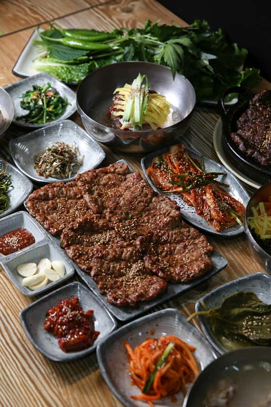
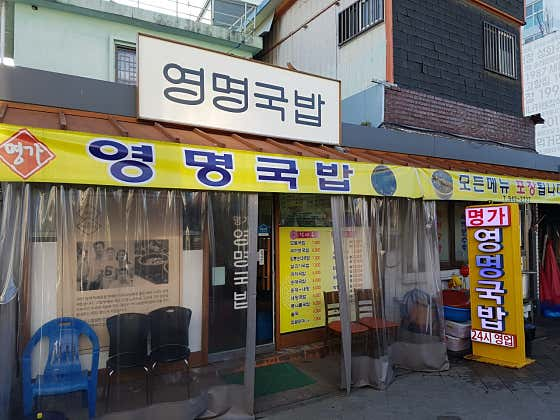
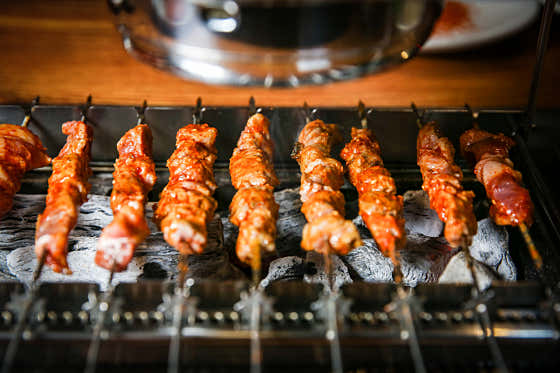
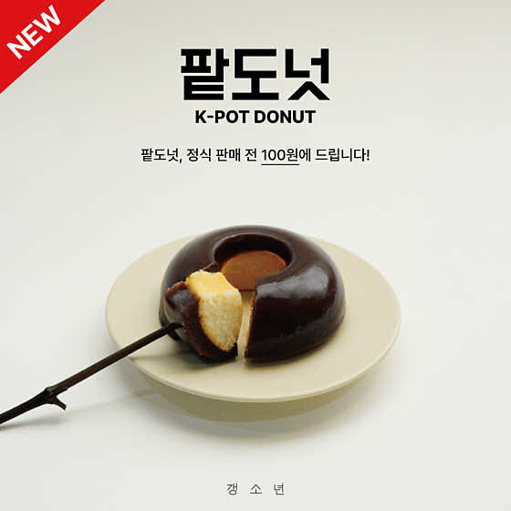
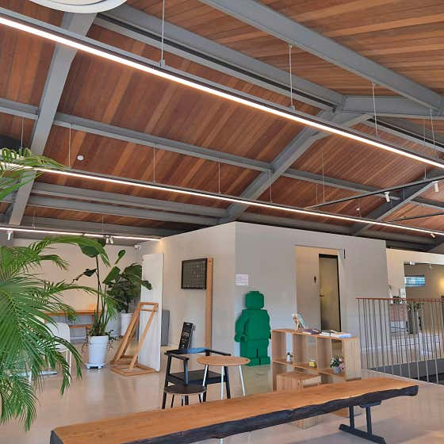
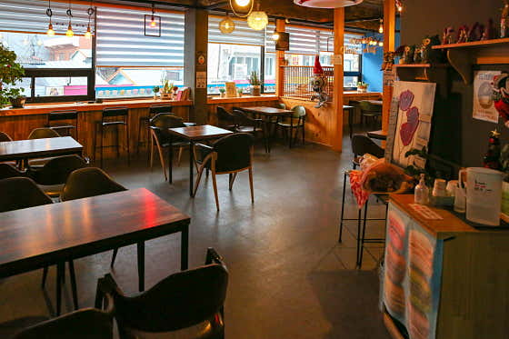

# 광주송정역 & 챔피언스필드 근처 맛집 & 카페 추천

> 조사일: 2026-11-12 · 출처: 네이버 플레이스 검색 결과(별점·리뷰 수·영업시간·가격은 조사 시점 기준), 야구팬 카페·원정 후기
> 1부 광주송정역 사진은 네이버 플레이스 업체 사진을 `research01/images/` 폴더에 받아둔 거예요. 같은 이름으로 파일만 바꾸면 사진이 교체됩니다.
> 2부 챔피언스필드 사진은 네이버 블로그 후기 사진을 불러와서 보여 주는 방식이에요. 사진 아래에 출처를 적었고, 저작권은 각 블로거에게 있습니다. 원본 글이 지워지면 사진이 보이지 않을 수 있어요.

## 목차

- [1부. 광주송정역](#1부-광주송정역)
  - 🍽️ 음식점 3곳 · ☕ 카페 3곳
- [2부. 광주-기아 챔피언스필드](#2부-광주-기아-챔피언스필드)
  - 🍽️ 음식점 5곳 · ☕ 카페 5곳 · 🌟 광주 대표 먹거리 2곳
- [📍 한눈에 보기](#-한눈에-보기)

---
---

# 1부. 광주송정역

> KTX·SRT가 서는 광주송정역과 1913송정역시장 주변의 맛집·카페예요. 기차 타기 전후로 들르기 좋은 곳 위주로 골랐어요.

## 🍽️ 음식점

### 1. 빛고을떡갈비 광주송정본점

- **분류**: 떡갈비(육류·고기요리)
- **주소**: 광주 광산구 광산로29번길 14 1층
- **별점/리뷰**: ★4.78 · 리뷰 7,215개
- **대표 메뉴**: 한우숯불떡갈비 26,000원 / 돼지숯불떡갈비 17,000원 / 육회비빔밥

**추천 이유**
송정리 하면 떡갈비죠. 이 집은 리뷰가 7천 개가 넘을 만큼 검증된 곳이고, 기본으로 나오는 맑은 등뼈국(리필 가능)이 특히 칭찬을 많이 받아요. 떡갈비에 육회비빔밥을 곁들이는 조합이 인기이고, 행정안전부 '착한가격업소'로도 선정됐어요.

**키워드**: `#송정리떡갈비` `#육회비빔밥` `#착한가격업소`

---

### 2. 영명국밥해장국

- **분류**: 국밥·해장국
- **주소**: 광주 광산구 송정로8번길 5 (송정역 2번 출구 도보 약 2분)
- **별점/리뷰**: ★4.34 · 리뷰 4,167개
- **대표 메뉴**: 살코기국밥 10,000원 / 모듬국밥 11,000원 / 새끼보국밥 11,000원

**추천 이유**
송정역시장 바로 앞이라 기차 타기 전후로 들르기 딱 좋아요. 양이 많고 잡내가 적다는 평이 많고, 쫄깃한 암뽕순대가 들어간 국밥이 대표예요. 새벽 2시 30분까지 영업해서 늦은 시간에도 갈 수 있고, '수요미식회'에도 소개됐어요.

**키워드**: `#암뽕순대국밥` `#혼밥가능` `#늦게까지영업`

---

### 3. 장백산양꼬치 송정본점

- **분류**: 중식당·양꼬치
- **주소**: 광주 광산구 송정로1번길 20
- **별점/리뷰**: ★4.71 · 리뷰 860개
- **대표 메뉴**: 양꼬치구이(10개) 16,000원 / 양갈비살꼬치 / 옥수수온면

**추천 이유**
"광주 송정역 대표 양꼬치 맛집"으로 꼽히는 곳이에요. 숯불에 굽는 양꼬치가 잡내 없이 깔끔하다는 후기가 많고, 향신료가 세지 않은 옥수수온면도 인기 메뉴예요. 저녁 모임이나 술 한잔하기 좋은 분위기예요.

**키워드**: `#숯불양꼬치` `#옥수수온면` `#저녁모임`

---

## ☕ 카페

### 1. 갱소년

- **분류**: 카페·디저트(수제 양갱)
- **주소**: 광주 광산구 송정로8번길 7-4 1층
- **별점/리뷰**: ★4.77 · 리뷰 2,803개
- **대표 메뉴**: 팥도넛 3,800원 / 팥두유 슈페너 6,500원 / 무등산 양갱 상자 8pcs 30,000원

**추천 이유**
무채색 감성 인테리어의 수제 양갱 전문 카페예요. 디저트가 많이 달지 않아서 좋다는 평이 많고, 직접 내려주는 드립커피도 맛있다고 해요. 양갱 세트는 포장이 예뻐서 광주 기념품·선물용으로 딱이에요.

**키워드**: `#수제양갱` `#감성카페` `#선물추천`

---

### 2. 프로머스 (FROMUS)

- **분류**: 카페·디저트(대형 카페)
- **주소**: 광주 광산구 도산로9번길 43 (도산동, 송정역 근처)
- **별점/리뷰**: ★4.95 · 리뷰 2,234개
- **대표 메뉴**: 어스커피(only ice) 6,500원 / 어스레이디(only ice) 6,500원 / 아메리카노 4,000원

**추천 이유**
별점 4.95로 송정역 후보 중 평이 가장 좋은 커피 전문 카페예요. 원목 가구를 만드는 사장님이 직접 꾸민 넓은 공간이라 분위기가 좋고, 가구도 살 수 있어요. 시그니처 크림라떼 '어스커피'가 특히 인기예요. 주차가 편하고 21시까지 주문할 수 있어요.

**키워드**: `#대형카페` `#원목감성` `#크림라떼`

---

### 3. 청자다방 송정역점

- **분류**: 카페·디저트
- **주소**: 광주 광산구 광산로 5 (광주송정역 1번 출구에서 약 137m, 1913송정역시장 맞은편)
- **별점/리뷰**: 리뷰 554개 (별점 정보 없음)
- **대표 메뉴**: 리얼군고구마라떼 / 흑당라떼 / 인절미 빙수

**추천 이유**
송정역에서 걸어서 2분 정도라 기차 시간을 기다리며 들르기 제일 편해요. 아메리카노가 1천 원대로 저렴하고, 군고구마라떼와 흑당라떼가 대표 메뉴예요. 23시까지 영업해서 늦은 기차 시간에도 이용할 수 있어요.

**키워드**: `#역앞카페` `#군고구마라떼` `#가성비`

---
---

# 2부. 광주-기아 챔피언스필드

> 챔피언스필드(챔필)에서 **걸어서 20분 안**에 있는 음식점 5곳·카페 5곳과, 조금 멀어도 가 볼 만한 광주 대표 먹거리 2곳이에요. 차 없이 오는 원정팬 기준으로 골랐어요.
> 거리는 챔필 중심에서 잰 직선거리이고, 영업시간은 토·일 기준이에요.

## 🍽️ 음식점

### 1. 금바다수산

![금바다수산 회 사진][img-gumbada]
*📷 사진 출처: 네이버 블로그 [I Dream (´･Д･)」](https://blog.naver.com/eun__possible/224453004997)*

- **분류**: 회·물회 포장
- **주소**: 광주 북구 서림로 19 (챔필 입구 앞 50m, 도보 약 4분)
- **별점/리뷰**: 정보 없음
- **대표 메뉴**: 챔필 물회BOX(포장) 20,000원 / 대방어회 혼술 1인용 37,000원 / 회덮밥 10,000원

**추천 이유**
두산 원정 직관 후기에서 "야구장 갈 때 포장해 가라"고 추천받은 곳이에요. 물회를 박스에 담아 야구장에 들고 들어갈 수 있어요. 토요일은 12시, 일요일은 15시에 문을 열고 월요일은 쉬어요.

**키워드**: `#물회포장` `#챔필바로앞` `#직관도시락`

---

### 2. 청와대 (중식당)

![청와대 짜장면과 짬뽕 사진][img-cheongwadae]
*📷 사진 출처: 네이버 블로그 [꿀찌의 취향](https://blog.naver.com/biggtory/224472823686)*

- **분류**: 중식당(짬뽕·탕수육)
- **주소**: 광주 북구 천변우로79번길 83 (챔필에서 도보 약 5~10분)
- **별점/리뷰**: 리뷰 약 1,700개 (별점 정보 없음)
- **대표 메뉴**: 짬뽕 8,000원 / 우삼겹짬뽕 11,000원 / 짜장 6,000원 / 미니탕수육 12,000원

**추천 이유**
야구 선수들도 찾는 곳으로 유명한 짬뽕집이에요. 가격이 착해서 행정안전부 '착한가격업소'로도 뽑혔어요. 주말에도 19시에 닫고 15:30–16:00에는 쉬는 시간이 있어서, 저녁 경기라면 경기 전에 드세요. 화요일은 쉬어요.

**키워드**: `#선수맛집` `#짬뽕` `#착한가격업소`

---

### 3. 하준족발보쌈

![하준족발보쌈 족발 사진][img-hajun]
*📷 사진 출처: 네이버 블로그 [Dide](https://blog.naver.com/yisubini_/224421573883)*

- **분류**: 족발·보쌈
- **주소**: 광주 북구 서림로 95 1층 (임동농협 정류장 건너편, 챔필에서 도보 약 15분)
- **별점/리뷰**: ★4.86
- **대표 메뉴**: 반반세트 중(족발+불족발) 43,000원 / 족발 소 35,000원 / 날치알 주먹밥 4,000원

**추천 이유**
별점 4.86의 족발집으로, 17시부터 밤 12시까지 열어서 경기가 끝난 뒤 늦은 저녁으로 먹기 좋아요. 네이버 예약도 되고 휴무일은 없지만, 재료가 떨어지면 일찍 닫아요.

**키워드**: `#경기후야식` `#불족발` `#늦게까지영업`

---

### 4. 이대포땔나무집

![이대포땔나무집 장작구이 사진][img-idaepo]
*📷 사진 출처: 네이버 블로그 [진호다섯끼](https://blog.naver.com/baer54/224420457669)*

- **분류**: 참나무 장작구이 고깃집
- **주소**: 광주 북구 중흥로 37 (챔필에서 도보 약 15분)
- **별점/리뷰**: 정보 없음
- **대표 메뉴**: 통삼겹바베큐 16,000원 / 갈매기살양념바베큐 15,000원 / 돼지껍데기 7,000원

**추천 이유**
KIA 선수들도 자주 찾는다는 오래된 고깃집으로, 참나무 장작 불향이 특징이에요. 토요일은 16시부터 23시 50분까지 열지만 **일요일은 쉬어요.** 토요일 경기 뒤에 가세요.

**키워드**: `#장작구이` `#노포고깃집` `#토요일추천`

---

### 5. 박소영왕만두

![박소영왕만두 만두 사진][img-mandu]
*📷 사진 출처: 네이버 블로그 [1상블로그..](https://blog.naver.com/eladus123/224469683703)*

- **분류**: 만두 포장
- **주소**: 광주 북구 대자로 64 (챔필에서 도보 약 18분)
- **별점/리뷰**: 정보 없음
- **대표 메뉴**: 작은고기만두(8개) 6,000원 / 작은김치만두(8개) 6,000원

**추천 이유**
롯데 팬카페 '나는 갈매기'의 챔필 원정 추천 글에서 "전화 주문"으로 추천된 곳이에요. 2인분부터 포장할 수 있어서 전화로 미리 주문하면 기다리지 않아도 돼요. 주말은 11시부터 17시까지만 열고, 월요일과 둘째·넷째 화요일은 쉬어요.

**키워드**: `#팬카페추천` `#만두포장` `#전화주문`

---

## ☕ 카페

### 1. 인크커피 광주기아챔피언스필드점

![인크커피 야구공빵 사진][img-inke]
*📷 사진 출처: 네이버 블로그 [엉뚱뚱 딴생각연구소](https://blog.naver.com/ungttung-ttung/224470815364)*

- **분류**: 카페·베이커리(대형 카페)
- **주소**: 광주 북구 서림로 10 (챔필 1루 쪽 1층, 야구장 건물 안)
- **별점/리뷰**: 정보 없음
- **대표 메뉴**: 야구공빵 5,000원 / 아메리카노 5,400원 / 바닐라빈 라떼 6,500원 / 제주 말차 라떼 6,800원

**추천 이유**
야구장 건물 안에 있는 약 800평짜리 카페로, 타이거즈 굿즈샵과 포토존까지 있어서 원정팬 필수 코스예요. 야구공 모양의 '야구공빵'이 명물이에요. 경기 날은 줄이 아주 길어서, 후기에서는 "오픈 시간이 가장 한산하다"고 해요. 영업은 10시부터 19시까지이고, 홈경기 날은 22시까지 하기도 한대요.

**키워드**: `#야구공빵` `#굿즈샵` `#원정필수코스`

---

### 2. 필로스팅하우스

![필로스팅하우스 사이폰 커피 사진][img-phil]
*📷 사진 출처: 네이버 블로그 [기록](https://blog.naver.com/diahzz/224305921574)*

- **분류**: 카페(사이폰 커피 전문점)
- **주소**: 광주 북구 무등로 20-1 2층 (챔필에서 도보 약 5~10분)
- **별점/리뷰**: 정보 없음
- **대표 메뉴**: 사이폰 8,000원 / 핸드드립 6,000원 / 카페라떼·플랫화이트 5,000원

**추천 이유**
유리 기구로 끓여 내리는 '사이폰' 커피를 맛볼 수 있는 작은 커피 전문점이에요. 커피 맛에 집중하고 싶은 분께 추천해요. 토요일은 11시부터 18시 30분까지 열고, **일요일·월요일은 쉬어요.**

**키워드**: `#사이폰커피` `#커피전문점` `#일요일휴무`

---

### 3. 크레페스타

![크레페스타 크레페 사진][img-crepe]
*📷 사진 출처: 네이버 블로그 [포밍 아카이브 Forming Archive](https://blog.naver.com/x_x0o_u/224338346350)*

- **분류**: 디저트(크레페)
- **주소**: 광주 북구 금호로 42 1층 (챔필에서 도보 약 10분)
- **별점/리뷰**: 정보 없음
- **대표 메뉴**: 크레페 베이스(누텔라/로투스/땅콩버터) 3,500원 / 생딸기 토핑 +2,000원 / 바나나 토핑 +1,000원

**추천 이유**
손에 들고 걸으며 먹기 좋은 간식이라, 경기 전에 사서 야구장으로 가기 좋아요. 다만 14시 30분에 열고 19시 30분에 닫으니, 낮 경기 전이라면 시간을 확인하세요. 화요일은 쉬어요.

**키워드**: `#크레페` `#들고먹는간식` `#가성비`

---

### 4. 아스테리

![아스테리 디저트와 음료 사진][img-asteri]
*📷 사진 출처: 네이버 블로그 [in a day](https://blog.naver.com/166_v/224142843767)*

- **분류**: 카페·디저트
- **주소**: 광주 북구 운용로 31 1층 (경신여고 언덕, 챔필에서 도보 약 15분)
- **별점/리뷰**: 정보 없음
- **대표 메뉴**: 페레로로쉐 라떼 7,000원 / 브라운치즈 크로플+아이스크림 8,500원 / 아메리카노 4,500원 / 소금빵 3,000원

**추천 이유**
'광주 기아 근처 카페'로 소개된 감성 디저트 카페예요. 아침 7시 30분부터 밤 11시까지, 휴무 없이 열어서 경기 전이든 후든 언제 가도 좋아요.

**키워드**: `#감성카페` `#페레로로쉐라떼` `#아침부터밤까지`

---

### 5. 무화과로스터스

![무화과로스터스 커피 사진][img-muhwa]
*📷 사진 출처: 네이버 블로그 [칸로그 ෆ](https://blog.naver.com/wngml3410/224451946835)*

- **분류**: 카페(로스터리, 직접 원두를 볶는 카페)
- **주소**: 광주 북구 금호로 79 2층 (챔필에서 도보 약 15분)
- **별점/리뷰**: 정보 없음
- **대표 메뉴**: 롱블랙 4,300원 / 핸드드립·디카페인·테린느(가격은 매장 확인)

**추천 이유**
교회 의자와 큰 공용 테이블이 있는 분위기 좋은 로스터리 카페예요. 진한 커피를 좋아하는 분께 추천하고, **밤 12시까지** 열어서 경기가 끝난 뒤 여운을 즐기기에도 좋아요.

**키워드**: `#로스터리카페` `#진한커피` `#밤12시까지`

---

## 🌟 광주 대표 먹거리 (도보 20분 밖)

> 걸어가기엔 멀지만 광주까지 왔다면 들러 볼 만한 곳이에요. 두 곳 모두 광주역·NC백화점 근처에 있고 서로 가까워서, 경기 전에 택시나 버스로 들렀다가 야구장으로 오는 코스를 추천해요.

### 1. 창억떡 중흥본점

![창억떡 호박인절미 사진][img-changeok]
*📷 사진 출처: 네이버 블로그 [두근대박파파](https://blog.naver.com/jungunoh/224451810361)*

- **분류**: 떡집(호박인절미)
- **주소**: 광주 북구 경열로 242 (NC백화점 맞은편, 챔필에서 차로 6~10분 · 광주역에서 도보 약 9분)
- **별점/리뷰**: 정보 없음
- **대표 메뉴**: 호박인절미 1kg 15,000원 / 호박인절미 12개 개별 포장 18,000원 / 소분 트레이 3,500원

**추천 이유**
롯데 팬카페 원정 추천 글의 1순위인 곳이에요. "선물용보다 개별 포장이 더 맛있다"는 팁이 있어요. 매일 7시부터 20시까지 연중무휴지만, 경기가 있는 주말엔 줄이 아주 길어요. 동명점 등 다른 지점이 덜 붐빈다는 후기도 있어요.

**키워드**: `#호박인절미` `#광주기념품` `#팬카페1순위`

---

### 2. 영미오리탕

![영미오리탕 오리탕 사진][img-ori]
*📷 사진 출처: 네이버 블로그 [우주먼지 유랑단](https://blog.naver.com/lamelancolie/224466674643)*

- **분류**: 오리탕
- **주소**: 광주 북구 경양로 126 (유동 오리탕 골목, 챔필에서 차로 약 5분)
- **별점/리뷰**: 정보 없음
- **대표 메뉴**: 오리탕 반마리 40,000원 / 오리탕 한마리 60,000원 / 오리로스·오리주물럭 61,000원

**추천 이유**
'광주 7미(7가지 대표 음식)' 중 하나인 오리탕의 대표 가게예요. 들깨 국물에 미나리를 넣고 초장 소스에 찍어 먹는 게 특징이에요. 반마리·한마리 단위라 2명 이상 함께 가기 좋고, 주말 15~17시는 쉬는 시간이니 피해서 가세요.

**키워드**: `#광주7미` `#들깨오리탕` `#2인이상추천`

---

### 💡 챔필 원정팬 꿀팁

- **이동**: 유스퀘어(버스터미널)에서 챔필까지는 버스로 금방이에요. 창억떡·오리탕은 광주역 쪽이라 택시로 묶어서 다녀오면 편해요.
- **짐 보관**: 챔필 물품보관함은 경기 시작 2시간 전부터 쓸 수 있어요.
- **일요일 주의**: 이대포땔나무집·필로스팅하우스는 일요일에 쉬고, 금바다수산은 15시에 열어요.
- **경기 끝난 뒤**: 하준족발보쌈(24시), 무화과로스터스(24시), 아스테리(23시)는 늦게까지 열어요.

---
---

## 📍 한눈에 보기

| 지역 | 구분 | 가게 | 별점(리뷰) | 키워드 |
|---|---|---|---|---|
| 송정역 | 음식점 | 빛고을떡갈비 광주송정본점 | 4.78 (7,215) | 송정리떡갈비 · 육회비빔밥 · 착한가격업소 |
| 송정역 | 음식점 | 영명국밥해장국 | 4.34 (4,167) | 암뽕순대국밥 · 혼밥가능 · 늦게까지영업 |
| 송정역 | 음식점 | 장백산양꼬치 송정본점 | 4.71 (860) | 숯불양꼬치 · 옥수수온면 · 저녁모임 |
| 송정역 | 카페 | 갱소년 | 4.77 (2,803) | 수제양갱 · 감성카페 · 선물추천 |
| 송정역 | 카페 | 프로머스 | 4.95 (2,234) | 대형카페 · 원목감성 · 크림라떼 |
| 송정역 | 카페 | 청자다방 송정역점 | - (554) | 역앞카페 · 군고구마라떼 · 가성비 |
| 챔필 | 음식점 | 금바다수산 | - | 물회포장 · 챔필바로앞 · 직관도시락 |
| 챔필 | 음식점 | 청와대 (중식당) | - (약 1,700) | 선수맛집 · 짬뽕 · 착한가격업소 |
| 챔필 | 음식점 | 하준족발보쌈 | 4.86 | 경기후야식 · 불족발 · 늦게까지영업 |
| 챔필 | 음식점 | 이대포땔나무집 | - | 장작구이 · 노포고깃집 · 토요일추천 |
| 챔필 | 음식점 | 박소영왕만두 | - | 팬카페추천 · 만두포장 · 전화주문 |
| 챔필 | 카페 | 인크커피 챔피언스필드점 | - | 야구공빵 · 굿즈샵 · 원정필수코스 |
| 챔필 | 카페 | 필로스팅하우스 | - | 사이폰커피 · 커피전문점 · 일요일휴무 |
| 챔필 | 카페 | 크레페스타 | - | 크레페 · 들고먹는간식 · 가성비 |
| 챔필 | 카페 | 아스테리 | - | 감성카페 · 페레로로쉐라떼 · 아침부터밤까지 |
| 챔필 | 카페 | 무화과로스터스 | - | 로스터리카페 · 진한커피 · 밤12시까지 |
| 챔필 | 대표 먹거리 | 창억떡 중흥본점 | - | 호박인절미 · 광주기념품 · 팬카페1순위 |
| 챔필 | 대표 먹거리 | 영미오리탕 | - | 광주7미 · 들깨오리탕 · 2인이상추천 |

> ※ 영업시간·가격은 바뀔 수 있으니 방문 전 네이버 지도에서 한 번 더 확인해 주세요.

<!-- 사진 주소 모음 (2부 챔피언스필드 · 네이버 블로그 이미지) -->
[img-inke]: https://search.pstatic.net/common/?src=http%3A%2F%2Fblogfiles.naver.net%2FMjAyNjExMDlfMTAz%2FMDAxNzk0MjI4MDY5Nzk4.RijktJH1rOnICxH5ZrRUDDM6Cp0bxjz2yByB1y1RQ4Ag.iho1sJqYYLrQhZjKkXETU9earYL2UroBsH4FZ1uqNS0g.JPEG%2F20250205_163050.jpg%232252x4000&type=w560_sharpen
[img-gumbada]: https://search.pstatic.net/common/?src=http%3A%2F%2Fblogfiles.naver.net%2FMjAyNjEwMjVfOTUg%2FMDAxNzkyOTAwOTA0NjQ2.QrAj4mC2flxQfB14dZUAyKpp6eXqXBMfZ1KI7y8IBc8g.GFNCRpWN8XpIiXT6B0CjwSy7cM6In3V_C_wBhfS9CmMg.JPEG%2FIMG%25A3%25DF7414.jpg%23900x1200&type=w560_sharpen
[img-cheongwadae]: https://search.pstatic.net/common/?src=http%3A%2F%2Fblogfiles.naver.net%2FMjAyNjExMTFfMTMx%2FMDAxNzk0MzY3ODA2Mzgy.iVigPDKeE1jxeE0_QaB_WeAlqlbzKYaJH8t6bR8XMjwg.98VHYdfCzFV0lOiTxvM-YRlhwfKCT9i3Y2EX-7Qrzp0g.JPEG%2Foutput%25A3%25DF4053695408.jpg%23854x1139&type=w560_sharpen
[img-hajun]: https://search.pstatic.net/common/?src=http%3A%2F%2Fblogfiles.naver.net%2FMjAyNjA5MjNfMjcw%2FMDAxNzkwMTc1NTkxODk3.idcQcHHbRWha3dMtc9Rd1mbeSnEjfktJJIjUld0GIaUg.0yPcte2SBcsZLmxBoj5K24ft2NVlGR6KiEB8CokYbDAg.JPEG%2FIMG%25A3%25DF1839.JPG%23900x1200&type=w560_sharpen
[img-idaepo]: https://search.pstatic.net/common/?src=http%3A%2F%2Fblogfiles.naver.net%2FMjAyNjA5MjNfMjI5%2FMDAxNzkwMTAwODg0MzU4.olJzvQWIPMQdLg36406UCHtCDaW81MUE5ljOyXBktWgg.DqHMTkscfUiAlKmAq1TLxo_R8atpJxKyPvJD4B2ABo4g.JPEG%2F20260807_202501.jpg%233000x3000&type=w560_sharpen
[img-mandu]: https://search.pstatic.net/common/?src=http%3A%2F%2Fblogfiles.naver.net%2FMjAyNjExMDlfMjE3%2FMDAxNzk0MTUxODEwMzkx.yMGoI_W0My9Aq3v6Ja75U44abcTeC6iP1gKkrKQJ6KQg.tJgOkjR9TVCegwRmUtZdEICssAnS20Ww2HR7I5SQVAYg.JPEG%2F%25B9%25DA%25BC%25D2%25BF%25B5%25BF%25D5%25B8%25B8%25B5%25CE_%25283%2529.jpg%233000x2250&type=w560_sharpen
[img-phil]: https://search.pstatic.net/common/?src=http%3A%2F%2Fblogfiles.naver.net%2FMjAyNjA2MDRfMTY1%2FMDAxNzgwNTYwNjYyNjEw.vaQv8HZHc_LQkEje8cYAihvkYZWMbWjyygLZBdlXi9Ag.XT4nicjoB6lNoxv6XkV3Sce29aCNtBqkTq_pvqU3jDwg.GIF%2F20260603_135224.gif%23640x640&type=w560_sharpen
[img-crepe]: https://search.pstatic.net/common/?src=http%3A%2F%2Fblogfiles.naver.net%2FMjAyNjA3MDdfMTU0%2FMDAxNzgzMzc4MjczMTk0.0QM-16w5450btf5azWk0NGgeyvVLB7XRvfBiuPXFZEgg.TkzXptGovesYcEnFWJ1dABNPNDGpx9hmjhNqDe4EgbQg.JPEG%2F5ACBB9AE%25A3%25AD3525%25A3%25AD435B%25A3%25AD83B1%25A3%25ADF2C78C89DB2B.jpg%23900x900&type=w560_sharpen
[img-asteri]: https://search.pstatic.net/common/?src=http%3A%2F%2Fblogfiles.naver.net%2FMjAyNTEyMjFfNDgg%2FMDAxNzY2MzI2Njc0MjE1.SA6AVPByAMurC01kLY5OzIW2Wt5_Aqf6kzKxZogb094g.tK03mb8cCyT6iRhks_8xXKthVCHQ0o65pDXUKHKu8dEg.JPEG%2FIMG%25A3%25DF5538.jpg%23900x1200&type=w560_sharpen
[img-muhwa]: https://search.pstatic.net/common/?src=http%3A%2F%2Fblogfiles.naver.net%2FMjAyNjA5MTZfNTcg%2FMDAxNzg5NTUzMzE2NzU2.FImEkyJg6ADROQCCrhzk1DtHXFYw7rpNWumoCEvTuBEg.PyQTXcol59TVtVtJPgWw1zQJM9szZi42ztfTedyOq-gg.JPEG%2FKakaoTalk_20260914_114038420_18.jpg%233024x4032&type=w560_sharpen
[img-changeok]: https://search.pstatic.net/common/?src=http%3A%2F%2Fblogfiles.naver.net%2FMjAyNjEwMjRfNDUg%2FMDAxNzkyNzY4Nzc1ODky.DIzGDjUU6FmJzUImVCj0TnyfPoAIHZz40Liv3IOggPUg.Ayd8Tw550dGHVIXUG6I29sGwk98azx8qHNYOnEa5Eo0g.JPEG%2F20260922_204648.jpg%233000x1386&type=w560_sharpen
[img-ori]: https://search.pstatic.net/common/?src=http%3A%2F%2Fblogfiles.naver.net%2FMjAyNjExMDVfMjc3%2FMDAxNzkzODU3NDk5Njk3.qfLicVlVr_5tcRYurZEY3AdpFd60RvazT4TwL819gKQg.bIr3ZNAi3K94oHSEPY61-6wBjjLjArqKZfhESpoOAx0g.JPEG%2FKakaoTalk_20261104_193236351.jpg%232250x3000&type=w560_sharpen
